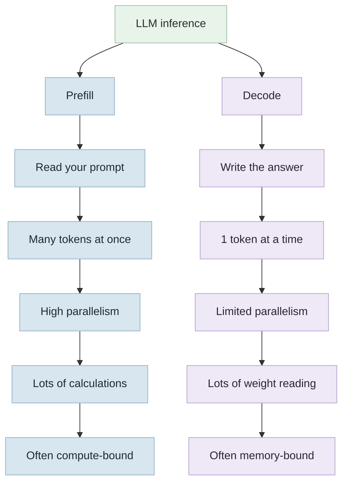

AI inference comes down to compute and memory. To generate tokens, we do a lot of arithmetic: multiplying and adding numbers and matrices. We need a machine built for that, so we use GPUs.

For a model to answer a prompt, it goes through two phases.

- Prefill: The prompt that have been converted into tokens by [tokenizer](https://huggingface.co/learn/llm-course/en/chapter2/4). The model weights are loaded into memory once, and the arithmetic runs against those tokens in parallel. Assume a 27-billion-parameter model such as Qwen 3.8-27B, with each weight stored as two bytes. The operations are adds and multiplies.
	- "What is the weather in Lagos" -> tokens -> weights moved into memory once -> a compute-heavy calculation against the tokens -> the result saved in the KV cache, so we can retrieve it later as context.

- Decode: When the model is ready to reply, decode starts. Each decode step produces one token. For every output token, we load the model weights back into memory so the calculation can run.

Prefill and decode run into different bottlenecks.

Prefill is compute-bound. The weights are loaded once, and a lot of matrix multiplications run in parallel.

Decode is memory-bound. To generate one token, the model has to load the weights and the KV cache and multiply them. It does that again for every token still left to generate. We are limited by how fast we can move the weights in for the calculation. While the weights are moving, the compute is just waiting for work.

Part of inference engineering is trying to fix these compute and memory bottlenecks in both the prefill and decode steps. That is why a lot of benchmarks measure:

- TTFT (time to first token): Prefill affects this. How fast can we produce the first token? That depends on how fast prefill finishes.
- TPOT (time per output token): Decode affects this. How fast can we produce each following token?

FLOP/s is floating-point operations per second: how much math we can do.

TB/s is how fast we can move data for those operations: the weights times their bit width(4bit, 8bit, 16bit, 32bit, 64bit. Techniques like quantization can reduce the bit width), plus the KV cache.

This is my understanding at the moment, i might be wrong, the aim is to learn more and more as i go along.